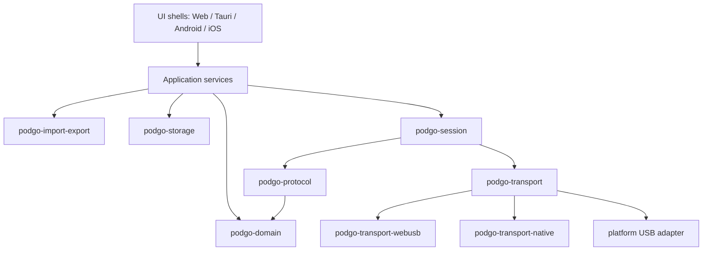
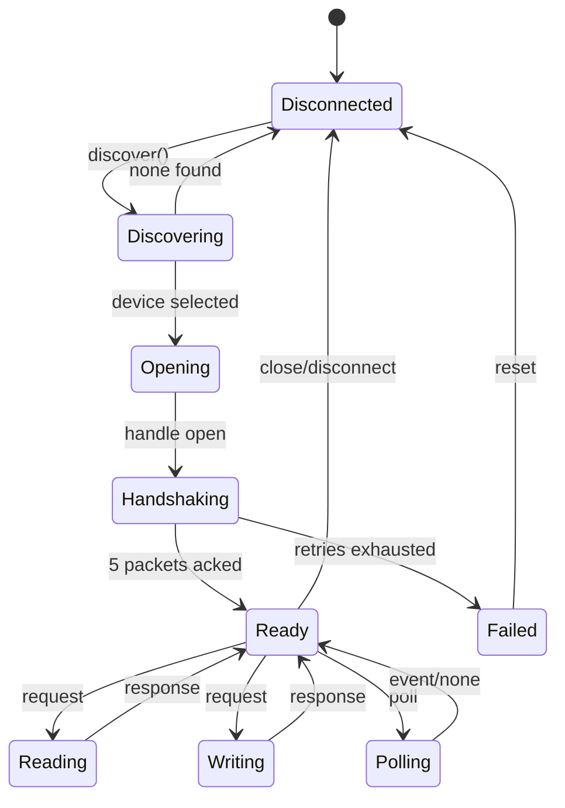
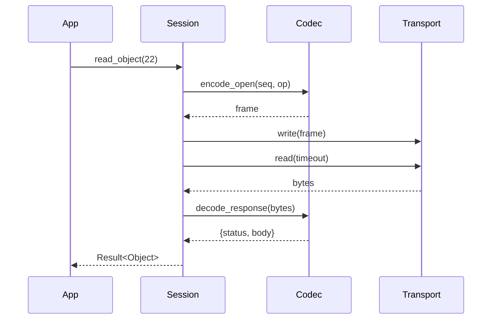
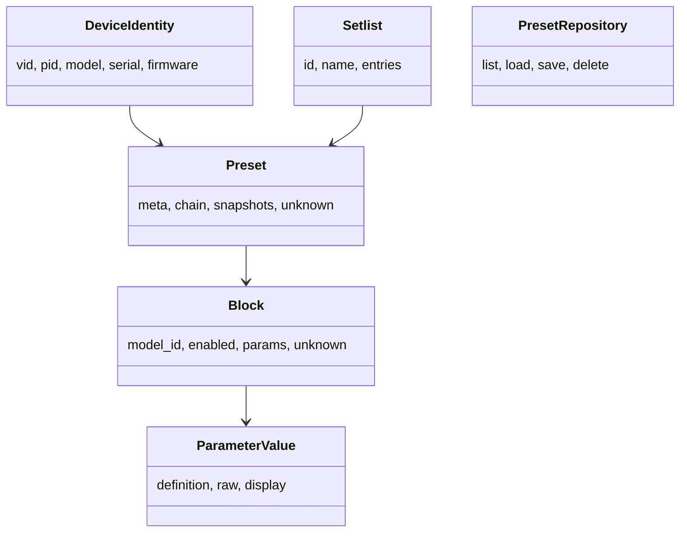

# System design

Status: Phase 2 baseline.
Companion: ADR-0001 … ADR-0007.

## 1. Layering



**Hard rule:** arrows point downward only. `podgo-domain` and `podgo-protocol`
have no platform dependencies. `podgo-session` depends only on
`podgo-transport`'s trait and `podgo-protocol`.

## 2. Crates

| Crate | Responsibility | Depends on |
|---|---|---|
| `podgo-domain` | MessagePack value model, preset/setlist/block/parameter types, validation, unknown preservation | std |
| `podgo-protocol` | Frame codec, commands, handshake templates, object ids, notification parsing | `podgo-domain` |
| `podgo-transport` | `Transport` trait, device ids, errors, mock | std |
| `podgo-session` | Connection state machine, request correlation, retry, streams | protocol, transport |
| `podgo-storage` | `PresetRepository` trait + implementations | domain |
| `podgo-import-export` | `.pgp`, `.pgb`, `.hlx` import/export | domain |
| `podgo-test-support` | Fixtures, mock transport, builders | protocol, session |
| `podgo-wasm` | `wasm-bindgen` API | all core crates |
| `podgo-ffi` | UniFFI API | all core crates |

## 3. Transport abstraction

```rust
pub trait Transport {
    fn write(&mut self, bytes: &[u8]) -> Result<usize, TransportError>;
    fn read(&mut self, buf: &mut [u8], timeout: Duration) -> Result<usize, TransportError>;
    fn close(&mut self) -> Result<(), TransportError>;
}
```

Discovery, permission and claiming are separate traits or constructors because
their UX differs per platform:

```rust
pub trait Discovery {
    fn list(&mut self) -> Result<Vec<DeviceId>, TransportError>;
}
```

Rationale: WebUSB permission requests are asynchronous and user-gesture bound;
Android permission is an `Intent`; libusb is synchronous. Keeping them out of
the byte-level trait avoids leaking platform UX into the session.

## 4. Connection state machine



Invariants:

- Exactly one request in flight per channel.
- A write is always followed by a read.
- Any timeout transitions to `Failed` unless the operation is retryable.
- Reconnect always performs a full handshake.
- Event polling requires a prior three-packet event-channel open; polling
  without it is an error, not an empty result.
- Every received event is acknowledged before the next poll, so bursts are
  drained in order and the cursor never repeats.

## 5. Request/response flow



Correlation uses the transaction id in body key `102` and the sequence byte.
Mismatched responses are discarded (not treated as success).

## 6. Domain data model



Ownership: values are owned; borrowing is limited to parse/serialize calls.
Versioning: every persisted document has `schema_version`; migrations are pure
functions with round-trip tests.

## 7. Synchronization model

- **Device → app:** poll events; update the active preset and dirty flags.
- **App → device:** explicit user action only; write commands gated.
- **Conflict:** if the device changed the same field after the local edit
  started, the UI must ask the user (keep local / take device / merge).
- **Never** auto-overwrite a device change.

## 8. Import/export

```text
.pgp  JSON  ──► PgpDocument ──► Preset
.pgb  AF6L + zlib ──► Backup { globals, setlists, irs }
.hlx  JSON  ──► HlxDocument ──► Preset
.blob l6-helix MessagePack ──► Preset
```

All importers are size-limited, path-safe and fuzz-tested. Export is atomic and
never overwrites without a backup.

## 9. Platform adapters

| Platform | Discovery/permission | Byte transport |
|---|---|---|
| Web | `navigator.usb.requestDevice` | WebUSB transfers |
| Windows/macOS/Linux | `rusb` enumeration | libusb bulk |
| Android | `UsbManager` + permission Intent | `bulkTransfer` |
| iOS | none verified | offline only (initially) |

## 10. Error model

```rust
enum AppError {
  Transport(TransportError),
  Protocol(ProtocolError),
  Domain(ValidationError),
  Storage(StorageError),
  Import(ImportError),
  Unsupported(PlatformLimitation),
}
```

Errors are typed, carry context, and never contain secrets. UI maps them to
actionable messages.

## 11. Logging

Structured, level-based, redacted. Device serials and file paths are hashed or
omitted. No network logging by default.

## 12. Deployment

- Web: static assets; `base` path configurable for GitHub Pages.
- Desktop: Tauri bundles per OS; signing/notarization documented.
- Android: APK/AAB with USB permission declared.
- iOS: offline build; transport module absent until verified.
